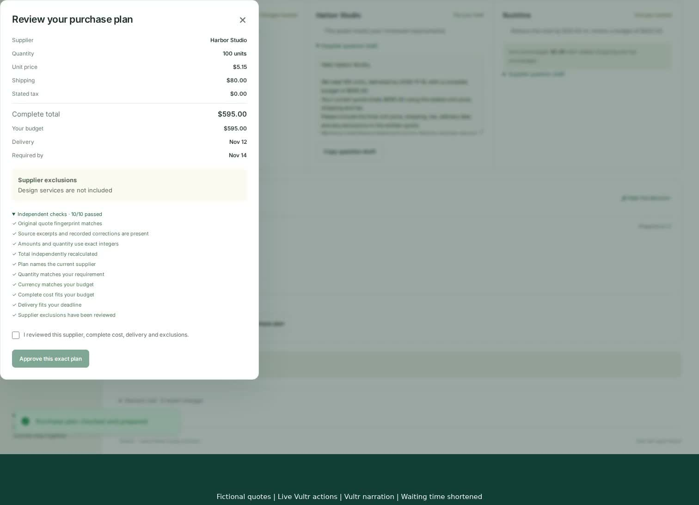

# Shortlist

**Compare supplier quotes. Check the facts. Keep your corrections.**

Shortlist helps you choose a supplier by comparing their quotes against your budget, order size and delivery deadline. It shows the complete price, explains why an offer fits or fails, and lets you check the original quote. If you correct a fact, such as a delivery date, you can lock it so the AI keeps your correction when it updates the comparison.

[Open Shortlist](https://shortlist.139.84.249.47.sslip.io/home) · [Watch the public Builder.io Clips demo](https://clips.agent-native.com/share/Vh5lcfDQTQX1) · [Explore the guided tour](https://shortlist-buying.vercel.app) · [Download the narrated video](https://shortlist-buying.vercel.app/demo/shortlist-demo.mp4)

## Problem and solution

You need 100 workshop kits. Three suppliers send quotes with different prices, shipping charges and delivery dates. The cheapest offer looks good until you call the supplier and learn that it will arrive too late.

Shortlist keeps the quote and your correction together. The recommendation changes when your budget or deadline changes. A later AI review can update the supplier's other facts while preserving the date you verified.

Shortlist is built for small operations teams comparing one-off purchases in emails or a spreadsheet. It helps a buyer explain a decision: which offer met the requirements, where each number came from, and what a person corrected.

## A decision you can try

The [public Clips recording](https://clips.agent-native.com/share/Vh5lcfDQTQX1) shows the actual authenticated app using fictional supplier quotes and one genuine framework agent review. The agent reads a refreshed quote and saves source-backed facts to PostgreSQL. The buyer's locked delivery date survives the review and reload. The recording also shows a budget change, undo and export.

The Clips link was checked while signed out. Its 54.5-second video plays with audible synthetic narration and matches the reviewed application recording. A [second player with English captions and a video download](https://shortlist-buying.vercel.app/demo/) shares the same footage.

To try your own comparison, [open the working app](https://shortlist.139.84.249.47.sslip.io/home), create an account and choose the example or paste a supplier quote. Each account has its own decisions. The public app passed sign-up with secure sessions, source-backed comparisons, saved corrections through reload, budget changes, undo, export and mobile browser checks.

The public [product tour](https://shortlist-buying.vercel.app) uses five preset fictional states recorded by the same domain engine as the authenticated app. It includes source inspection, a locked correction, a source refresh, changed constraints, undo of a tour step and an example evidence export. It does not invoke a model or persist a user workspace. `npm run build:tour -- --check` verifies those committed snapshots against the engine; `npm run test:tour` checks the browser flow.

The disclosed example contains three fictional quotes for 100 workshop kits:

| Supplier | Total, including shipping and stated tax | Delivery |
| --- | --- | --- |
| Cedar Print | $575 | November 13, 2026 |
| Harbor Studio | $595 | November 12, 2026 |
| Rushline | $625 | November 9, 2026 |

Start under a $650 budget with November 14 delivery. Cedar is selected. Correct Cedar's date to November 18 and lock it; Harbor becomes the recommendation. Lower the budget to $590; no suitable offer meets all requirements. With a $650 budget and November 10 deadline, Rushline is selected. The locked correction survives.

Select a source-linked fact to highlight its exact quote excerpt. Undo the most recent change or export the decision with its source evidence.

## Why this is useful

- Supplier quotes present costs and dates differently. Shortlist brings them into a common comparison while preserving the original text.
- A fact learned by a person can matter more than an old quote. Corrections keep their reason and can be protected from later agent extraction.
- Requirements change. The recommendation, rejection reasons and decision trail update together.
- An uncertain answer is actionable. Unknown tax, quantity, currency, delivery or unreviewed exclusions prevents an offer being selected.

## Why Agent-Native matters here

The [Builder.io hackathon](https://www.builder.io/hackathon/rules) puts 40% of the score on usefulness and execution, and 20% each on creativity and design, the people-and-agent workflow, and use of Agent-Native. Shortlist brings those parts together in one buying decision: readable comparisons, source inspection, saved agent work and corrections the buyer controls.

[Agent-Native](https://github.com/BuilderIO/agent-native) gives the person and agent shared actions, shared data and the context of the current screen. That is useful for a buying decision: the agent needs to work with the quotes and corrections the buyer is looking at, and its saved work needs to appear in that same comparison.

| What the buyer does | What the agent does | Shared implementation |
| --- | --- | --- |
| Opens a decision and selects a supplier | Reads that decision, selected supplier and source text | [Screen context](actions/view-screen.ts), [quote reads](actions/get-quote.ts) |
| Checks a price against its original quote | Saves extracted facts with exact supporting excerpts | [Extraction action](actions/apply-extraction.ts) |
| Changes the budget or deadline | Reads the updated requirements and resulting ranking | [Requirements action](actions/update-requirements.ts), [decision action](actions/get-decision.ts) |
| Corrects and locks a delivery date | Preserves that human correction during extraction | [Human correction](actions/correct-quote.ts), [extraction action](actions/apply-extraction.ts) |
| Replaces a quote, undoes a change or exports the decision | Uses the committed decision state | [Source replacement](actions/replace-quote-source.ts), [undo](actions/undo-decision.ts), [export](actions/export-decision.ts) |

The interface uses `useActionQuery` and `useActionMutation`; the framework agent uses the registered actions as tools. Both paths validate the request and check the authenticated owner. Human correction and lock controls are reserved for the person.

Writes reject stale versions, save the change and its history in one PostgreSQL transaction, and verify the committed result. Replacing quote text invalidates facts extracted from the old source. Undo restores the earlier content at a new version. The recorded agent review returned a verified receipt for the saved change.

Shortlist was created from the official default scaffold with core/toolkit **0.223.0**, inspected against source revision **f34b2ff2da31192a5a6ce372f33e65a6a9e1dc11**. The quote comparison, evidence checks, protected corrections and decision history were built for this project during the hackathon window.

## Run and verify

Node 22.22 or newer is required.

1. Install the locked dependencies with npm ci --no-audit --no-fund.
2. Copy .env.example to .env and generate a stable BETTER_AUTH_SECRET. For local development, PGlite is supported. Hosted deployments require persistent PostgreSQL.
3. Run npm run dev. Open the URL, create an account and try the example.
4. Configure a supported model connection through the framework settings. Quote text and conversation leave the app for that connected provider when the agent runs.

For an isolated PostgreSQL test database, run npm run migrate:production, npm test, npm run typecheck, npm run agent-native:doctor, npm run build and npm run test:browser. The verification workflow performs these checks and retains screenshots/traces on failure. npm run test:domain needs no database or provider key.

The sponsored agent is disabled by default. When an operator enables it, the server requires per-user and global daily turn allowances. Code execution and broad framework tools are disabled for this buying workflow.

## Deployment

The production deployment needs DATABASE_URL for persistent PostgreSQL and BETTER_AUTH_SECRET for stable sessions. Apply migrations before promotion. The framework's documented Vercel build uses NITRO_PRESET=vercel; Node/Docker hosting is also supported.

The separate public tour and recorded demonstration deploy only the contents of `preview/`, with its nested Vercel configuration. The [authenticated application](https://shortlist.139.84.249.47.sslip.io/home) runs on Node with persistent PostgreSQL and a connected NEAR AI model. For this demonstration, an HTTPS gateway on Vultr reaches the existing application VPS through an encrypted SSH tunnel. The database remains available only on the private local listener. Each decision and its history belong to the signed-in owner.

Eight domain tests, seven isolated PostgreSQL action/storage tests, typecheck, framework doctor, production build, private-app browser checks and public-tour browser checks passed. [GitHub Actions](.github/workflows/verify.yml) defines the repeatable verification workflow. The required public Clips video is verified; the entrant still needs to complete the official submission.

## Practical scope

The first workflow accepts pasted text or CSV. Currency conversion, PDF extraction, purchasing and supplier messaging are outside this version. Exact citations verify that evidence exists in the source; they do not prove a natural-language interpretation is correct. Manual corrections are buyer assertions. Review the source and supplier terms before making a purchase.

MIT. The application scaffold comes from Builder.io's MIT-licensed Agent-Native project; application behavior was developed for Shortlist during the hackathon window.

See [entry preparation](SUBMISSION.md) for the verified Clips link, required deliverables and official rules.
